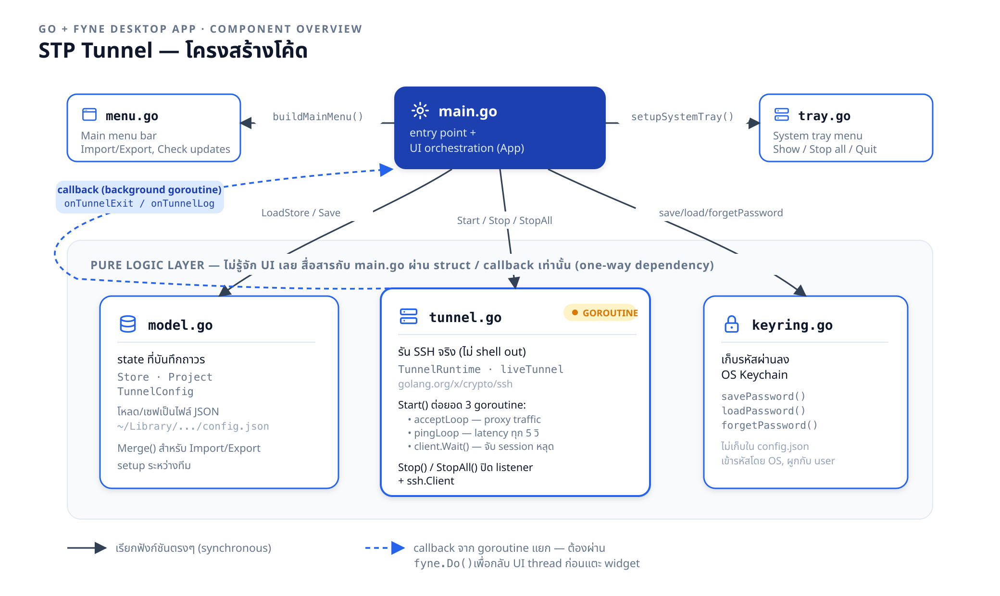
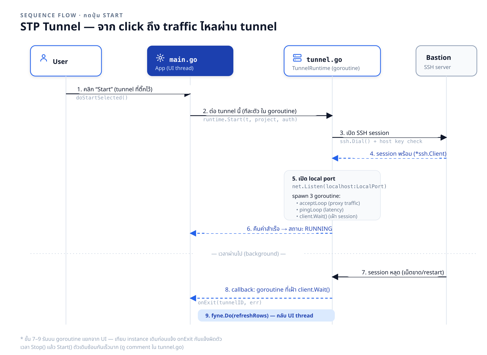

# STP Tunnel — โครงสร้างโค้ด

ไดอะแกรม 1–2 อธิบายว่าไฟล์ Go แต่ละไฟล์ทำหน้าที่อะไร และประกอบกันยังไงตอนรันจริง เริ่มจาก [main.go](../../main.go) เป็นจุดเริ่มต้น

## 1. Component overview

ไฟล์ต้นฉบับแก้ต่อได้: [component-overview.svg](component-overview.svg) · เวอร์ชันพิมพ์: [component-overview.pdf](component-overview.pdf)

**main.go เป็น orchestrator ตัวเดียวที่รู้จักไฟล์อื่นทั้งหมด** — เป็นคนเดียวที่ import ทั้ง [model.go](../../model.go), [tunnel.go](../../tunnel.go), [keyring.go](../../keyring.go), [menu.go](../../menu.go), [tray.go](../../tray.go) แล้วประกอบเข้าด้วยกันเป็น UI

- **menu.go / tray.go** — ส่วนขยาย UI ที่ main.go เรียกตรงๆ ตอน build (`buildMainMenu()`, `setupSystemTray()`)
- **model.go / tunnel.go / keyring.go** — ชั้น "pure logic" ไม่รู้จัก Fyne หรือ UI เลย สื่อสารกับ main.go ผ่าน struct หรือ callback เท่านั้น (dependency ทางเดียว จาก main.go ลงมา)
- **tunnel.go เป็นไฟล์เดียวที่รันบน background goroutine** — เมื่อ session หลุดเอง (เน็ตขาด, bastion restart) มันเรียก callback (`onTunnelExit`/`onTunnelLog`) กลับไปที่ main.go ซึ่งต้องห่อด้วย `fyne.Do()` เสมอก่อนแตะ widget ใดๆ เพราะ Fyne ไม่ยอมให้ goroutine อื่นอัปเดต UI ตรงๆ

## 2. Start flow (sequence)

ไฟล์ต้นฉบับแก้ต่อได้: [start-sequence.svg](start-sequence.svg) · เวอร์ชันพิมพ์: [start-sequence.pdf](start-sequence.pdf)

ไล่ตามสิ่งที่เกิดขึ้นตอนกดปุ่ม **Start**:

1. User ติ๊ก tunnel แล้วกด Start → `doStartSelected()` ใน main.go
2. main.go เรียก `runtime.Start(t, project, auth)` — ทีละ tunnel ใน goroutine ของตัวเอง
3. tunnel.go เปิด SSH session ไปยัง bastion (`ssh.Dial()` พร้อมเช็ค host key)
4. เมื่อ session พร้อม tunnel.go เปิด local port (`net.Listen`) แล้ว spawn 3 goroutine: `acceptLoop` (proxy traffic), `pingLoop` (วัด latency ทุก 5 วิ), และตัวที่เฝ้า `client.Wait()`
5. คืนสถานะ RUNNING กลับ main.go — จบ synchronous flow ตรงนี้
6. **ในอนาคต** (background, ไม่รู้ล่วงหน้าว่าเมื่อไหร่): ถ้า session หลุด goroutine ที่เฝ้า `client.Wait()` จะเรียก `onExit(tunnelID, err)` กลับมา main.go ต้องเรียก `fyne.Do(refreshRows)` เพื่อกลับ UI thread ก่อนอัปเดตตาราง

จุดที่ควรระวังเวลาแก้โค้ดส่วนนี้: ถ้า Stop() แล้ว Start() tunnel เดิมซ้อนกันเร็วมาก ต้องเทียบว่า `*liveTunnel` instance ที่เก็บใน `r.running[t.ID]` ยังเป็นตัวเดิมไหมก่อนจะลบ/แจ้ง exit — ไม่งั้น goroutine เก่าที่เฝ้า session ที่ถูก Stop ไปแล้วอาจไปรายงานว่า session **ใหม่** หลุดแทน (ดู comment ใน [tunnel.go](../../tunnel.go) ตรง `Start()`)

## 3. ภาพสำหรับผู้ใช้ (ใช้ใน [README.md](../../README.md))

สามภาพนี้เล่าว่าแอปทำอะไร ทำยังไง และผลลัพธ์เป็นแบบไหน สำหรับคนที่ไม่ได้อ่านโค้ด สร้างด้วย skill `dia-render` จาก spec JSON

| ภาพ | แบบ | เล่าเรื่องอะไร |
|---|---|---|
| [app-overview.png](app-overview.png) | flowchart | ทั้งแอป: Import หรือตั้งค่าเอง → Start → ใช้งาน → Export ให้ทีม |
| [tunnel-start-swimlane.png](tunnel-start-swimlane.png) | swimlane | กด Start แล้วผู้ใช้ / แอป / Keychain / Bastion ทำอะไรบ้าง |
| [tunnel-status.png](tunnel-status.png) | state machine | สถานะ STOPPED / RUNNING / ERROR และอะไรทำให้เปลี่ยน |

แต่ละภาพมี 4 ไฟล์ชื่อเดียวกัน: `.json` (ต้นฉบับ — แก้ที่นี่แล้ว render ใหม่), `.drawio.svg` (เปิดแก้ใน draw.io ได้), `.png`, `.pdf`
