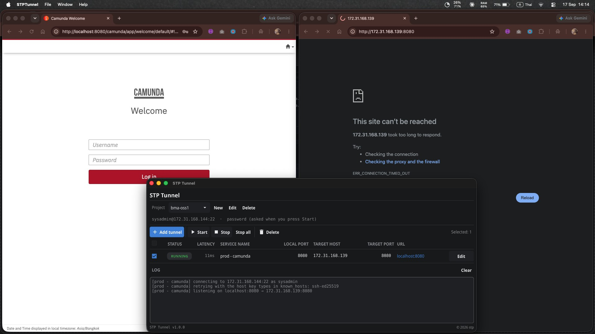

# หลักฐานการทดสอบ: STP Tunnel เข้าถึงได้ผ่าน Tunnel เท่านั้น

**วันที่ทดสอบ:** 2026-09-17
**ผู้ทดสอบ:** sitthiphong-krobkrong

## สรุปผลทดสอบ

ทดสอบเปรียบเทียบการเข้าถึง service ปลายทาง (Camunda, `172.31.168.139:8080`) ระหว่าง:

1. เข้าผ่าน **STP Tunnel** (SSH tunnel ผ่าน jump host)
2. เข้า **ตรง** ไปยัง IP:Port ของ target host โดยไม่ผ่าน tunnel

ผลลัพธ์ยืนยันว่า service ปลายทาง **ไม่ได้เปิดสาธารณะ** เข้าถึงได้เฉพาะผ่าน SSH tunnel เท่านั้น ซึ่งเป็นพฤติกรรมที่ถูกต้องตามการออกแบบด้านความปลอดภัย (ต้องผ่าน jump host ที่มีการควบคุมสิทธิ์)

## รายละเอียดการทดสอบ

### ฝั่งซ้าย: เข้าผ่าน STP Tunnel — สำเร็จ

- Tunnel profile: `bma-oss1` / service name `prod - camunda`
- เส้นทาง: `sysadmin@172.31.168.144:22` (jump host) → `localhost:8080` → `172.31.168.139:8080` (target)
- สถานะ: `RUNNING`, latency 11ms
- ผลลัพธ์: เปิด `http://localhost:8080/camunda/app/welcome/default/` เข้าหน้า Login ของ Camunda ได้ปกติ

Log จาก STP Tunnel:
```
[prod - camunda] connecting to 172.31.168.144:22 as sysadmin
[prod - camunda] retrying with the host key types in known_hosts: ssh-ed25519
[prod - camunda] listening on localhost:8080 → 172.31.168.139:8080
```

### ฝั่งขวา: เข้าตรงไปยัง IP:Port — ล้มเหลว

- URL ที่ทดสอบ: `http://172.31.168.139:8080`
- ผลลัพธ์: `ERR_CONNECTION_TIMED_OUT` ("This site can't be reached — 172.31.168.139 took too long to respond")

## ภาพหลักฐาน



## ข้อสรุป

- STP Tunnel ทำงานถูกต้อง สามารถ forward local port ไปยัง target ผ่าน jump host ได้สำเร็จ
- Target service ไม่เปิดพอร์ตให้เข้าถึงจากภายนอกโดยตรง ต้องผ่าน SSH tunnel/jump host เท่านั้น จึงเป็นไปตามข้อกำหนดด้านความปลอดภัยของระบบ
